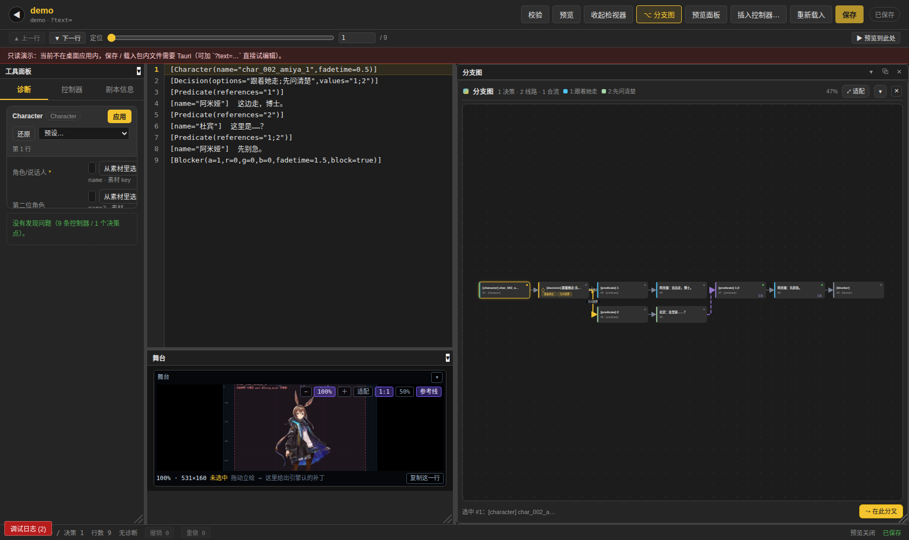
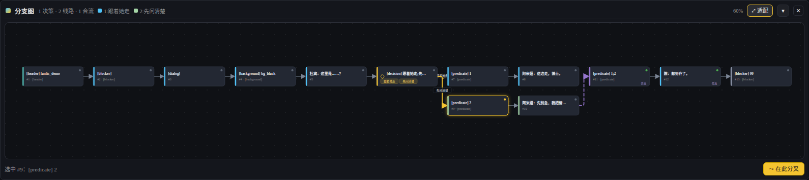
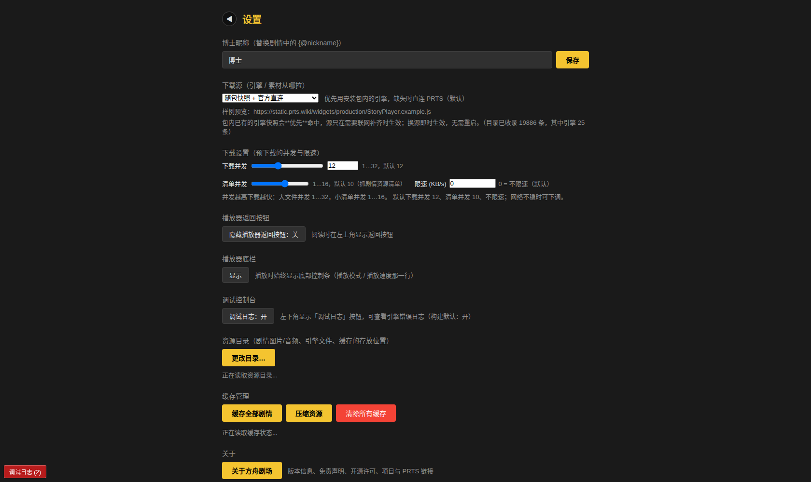
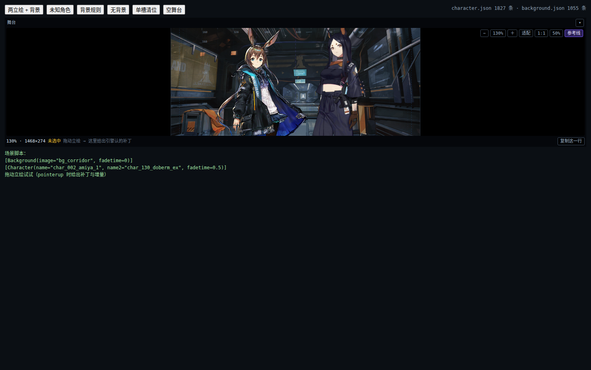
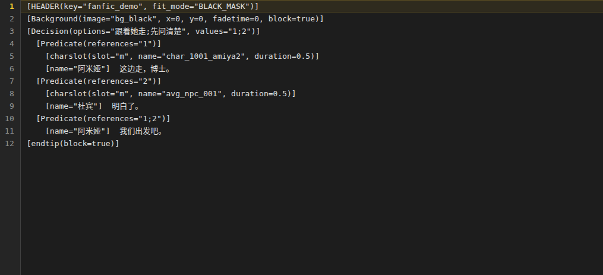
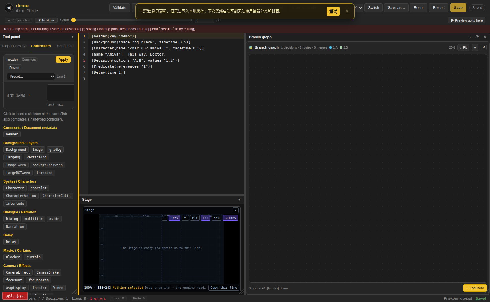
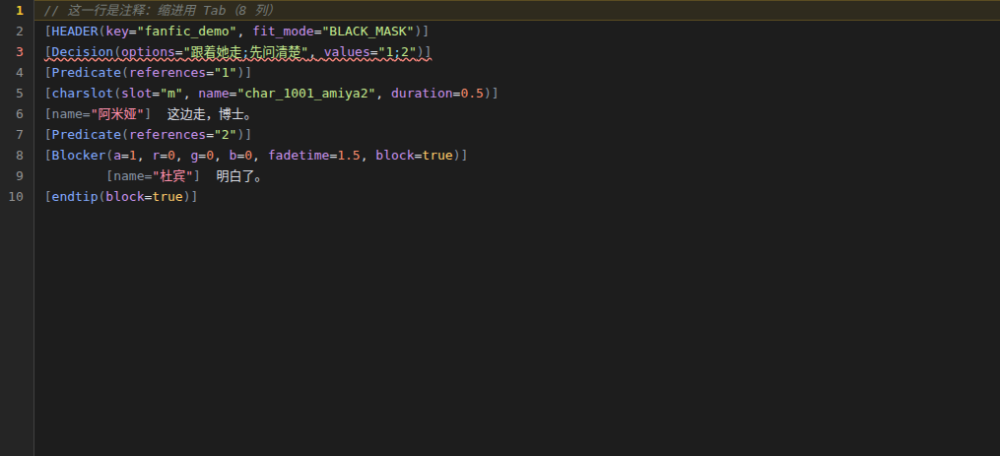

# 演出工作台（可拼接窗口）+ 舞台缩放 + 分支图 / 引擎快照 / 镜像源

> 面向开发者。用户向说明见仓库根 `README.md`；本页记录**模块边界、契约、回归命令**。
> 变更历史：2026-10-11「工作台 v1」——按用户反馈重做（缩放连续、面板语义、拼接、分支图排版、资源缓存/镜像）。

## 1. 工作台（`frontend/src/components/editor/`）

| 文件 | 职责 |
|---|---|
| `workbenchStack.ts` | **纯模型**（零 React/DOM）：`defaultState/normalize/ids/pathTo/move/resize/reorder/minimize/restore/stringify/parse/summarize`。布局是二叉树：`{t:"panel"\|"split"\|"holder"\|"min"}`，`share` clamp 0.12…0.88 |
| `workbenchLayout.ts` | `PANELS` / `WINDOW_SPECS`（标题、minW/minH、`kind: "dock"\|"map"`）+ 命名布局 `listLayouts/saveLayout/loadLayout/activeLayout` + `migrateLegacy()/consumeLegacy()`（旧 `prts-editor-windows:*` 一次性迁移） |
| `Workbench.tsx` / `workbench.css` | 递归 flex 渲染 + `[data-wb-gutter]` 分隔条 + 拖拽会话（≥4px）+ 边缘/中心 overlay（`[data-wb-overlay][data-wb-drop]`）+ 事件委托把手（标题条 `.ed-win-bar` 或 `data-drag-handle`） |
| `InspectorWindow.tsx` | 窗口壳：`shellKind: "dock"`（常驻，**无 ⧉ 无 ✕**）/ `"map"`（按需，`✕` 关闭、`⧉` 浮动） |
| `inspectorWindow.ts` / `PanelChrome.tsx` | `PanelChromeProps{title,ariaLabel,visible,onToggle?,onSelect?,active?}` + chrome 控件 |
| `stageZoom.ts` | 舞台缩放纯数学：`MIN .25 / MAX 2 / DEFAULT 1 / WHEEL_STEP .1`、`clampZoom/fitZoom/zoomAt`（滚轮锚点保值） |
| `StagePane.tsx` | 16:9 舞台：滚轮/±/适配/1:1/百分比；**缩放只改 `viewBox`**，几何 px 不变 |
| `BranchGraph.tsx` + `src/akstage/local/branchGraph.js` | dify 风 DAG：`layoutGraph()` 分层 + 正交折线 + 零重叠；`⤢ 适配`(0)、滚轮缩放、拖空白平移 |

### DOM 契约（harness 锚点，只增不改）

`[data-workbench]`、`[data-wb-panel="<id>"]`、`[data-wb-gutter]`、`[data-wb-overlay][data-wb-drop]`、
`[data-win="<title>"]`、`.ed-win-bar`、`.ed-win-btn`；
舞台：`[data-stage-pane]`、`[data-stage-svg]`、`[data-stage-status="zoom"]`、`[data-stage-action="zoom-in|zoom-out|zoom-reset|fit|zoom-1|zoom-05"]`、`[data-chrome="stage"]`；
分支图：`[data-branch-graph]`、`[data-branch-node]`、`[data-branch-layer]`、`[data-branch-edge]`、`[data-branch-path]`、`[data-branch-pan]`、`[data-branch-action="fit"]`、`[data-branch-empty]`、`[data-chrome="branch"]`。

### 持久化键

`prts-editor-wb:default`（当前布局）、`prts-editor-wb:<name>`（命名布局）、`prts-editor-wb:active`、`prts-editor-wb:migrated`（一次性）。

## 2. 引擎快照（随包 + 磁盘 + 网络）

- 随包：`src-tauri/resources/engine/v1/{snapshot.json,meta.json}`（3.4 MB，由 `scripts/fanfic/build-engine-bundle.mjs` 从 `scripts/fanfic/fetch-upstream.mjs` 产物生成），经 `engine_snapshot.rs` 的 `engine_snapshot_info/engine_snapshot_read` + `engine_pack_info` 暴露（`include_bytes!`，**离线可读**）。
- 前端：`enginePack.ts` 的顺序 **pack → 磁盘 cache（`cache/widget-bundle-v7`）→ 网络**；网络成功才回写 cache + `-previous`。
- 失败：`storyPlayerBoot.ts` 在 `viaSrc → viaInline → 重试 2 次（1.5s/3s）` 全失败后换来源；同时 `debugLog.pushStatus("engine", 人话, hint)` → UI 顶部**单条**横幅（`[data-asset-banner="1"]`），`data:`/`blob:` 的模块错误标 `silent`，只在调试面板可见。

## 3. 下载源 / 镜像

- `appSettings.ts`：`mirror: pack|prts|jsd|fastly|ghproxy|custom`、`customMirror`、`downloadConcurrency`（默认 **30**，1…32）、`manifestConcurrency`（**10**）、`rateLimit`（0=不限速）。
- `src/akstage/assetRouting.js`：源模板集中在 `MIRRORS`；`routeFor/buildSourceOrder/mirrorUrl/describe`、`toMirrorKey ⇄ fromMirrorUrl`、`canonicalKey`。**镜像仓需先跑 `.github/workflows/publish-mirror.yml`**（默认 `djkcyl/arkstage-mirror@main`），否则镜像 404 → 自动回退 prts。
- `src/akstage/engineCatalog.js` + `catalog-data.json`：引擎 25 条（css/js/font/src/data）、素材 19,861 条；`frontend/src/lib/engineCatalog.ts` 是 TS 包装。
- Rust：`download::DEFAULT_CONCURRENCY = 30`、`MAX_CONCURRENCY = 32`；`setDownloadSettings` 由设置页写入。

## 3.5 观感证据（截图）

| | |
|---|---|
| 工作台 + 分支图（常驻 dock / Map / dify 卡片） |  |
| dify 风分支图（分区卡片 + 正交连线 + 适配） |  |
| 设置 → 下载源 / 下载并发 |  |
| 舞台连续缩放（滚轮锚点、viewBox 变、几何不变） |  |
| 区域缩进（`[Decision]` 线路层级） |  |
| 舞台裁剪（150% 摘掉 clip = 素材带，对照见 `images/stage-clip-150-unclipped.png`） |  |
| 编辑器英文界面（`prts-language=en-US`） |  |
| 脚本文本语法着色 + Tab 缩进（8 列） |  |
| 编辑器舞台 150%（裁剪后：16:9，素材不再成条） |  |

## 4. 回归

```bash
cd <repo>
( nohup npm run dev > /tmp/arkstage-vite.log 2>&1 & )   # harness 前置：dev server :5174
node build/harness/demo-check.mjs                      # 编辑器/舞台/分支图/拼接 端到端
node build/harness/_stage-clip-check.mjs               # 舞台裁剪（16:9）+ 舞台/日志可调大小（51）
node build/harness/_indent-ui-check.mjs                # 区域缩进 UI（11）
node build/harness/_editor-tab-hl-check.mjs            # VSCode 键位（Tab/Enter/Backspace）+ 着色层逐像素对齐（31）
node build/harness/_stage-visual-check.mjs             # 编辑器舞台 100%/150% 的 16:9 观感证据
node build/harness/_i18n-check.mjs                    # i18n 运行时（7）
node build/harness/player-chrome.mjs                  # 播放器底栏（默认纯隐藏，10）
node scripts/fanfic/branchGraph-selftest.mjs           # 分支图语义（73）
node build/harness/branch-shot.mjs                     # dify 布局零重叠 + 截图
node build/ctx/… 见 build/harness/*.mjs
npx tsc -b frontend                                   # 类型
node frontend/scripts/check-i18n.mjs                  # locales 键对齐（zh-Hans 为参照）
npm run test:editor && npm run test:stage             # 编辑器 / 舞台内核
```

## 5. 已知门槛（人工）

- 镜像仓 `djkcyl/arkstage-mirror`（或 `assetRouting.js` 的 `MIRROR_REPO/MIRROR_REF`）需**先建空仓 + 配 `MIRROR_TOKEN`（contents:write）**，再手动跑一次 `.github/workflows/publish-mirror.yml`（只发引擎层 25 条 / ~17.6 MB）。未跑前 jsd/fastly/ghproxy 404 是**预期**，`buildSourceOrder` 会自动回退 `pack` → 官方直链。
- Windows / Android 上需真机验证 `snapshot.json` 的 `include_bytes!` 包体与 CSP；`snapshot.json` 升级引擎时由 `scripts/fanfic/build-engine-bundle.mjs` 重生成，并 bump `src-tauri/resources/engine/v<N>/`。

## 6. 编辑器反馈对照（第二轮：舞台 / 缩进 / i18n / 底栏）

| 用户原话 | 落点 |
|---|---|
| 播放器底栏要默认自动隐藏、**不要 3 秒无操作淡出** | `uiSettings.getPlayerChrome()` 默认 `auto`；`storyPlayerBoot::installPlayerChrome` 的 `auto` = 纯隐藏（`html.ark-chrome-auto` + 指针几何命中，无定时器）。回归 `node build/harness/player-chrome.mjs` |
| 下载并发数默认 30 | `appSettings.DEFAULT_SETTINGS.downloadConcurrency=30`、`download::DEFAULT_CONCURRENCY=30` |
| 舞台缩放「素材扭曲」 | **viewBox 之外的内容没被裁**：`StagePane` 加 `<clipPath id="ark-stage-clip">`（rect == 当前 viewBox），画布内容整体入组。150% 实测可见盒 AR 1.7875（摘掉 clip = 2.6813）。回归 `node build/harness/_stage-clip-check.mjs`（51 断言） |
| 舞台 / 日志不能自由调大小 | `StagePane` 根高 `fill` → `[data-wb-panel=stage]` 拖多大舞台多大（`data-stage-fill="1"`）；`DebugConsole` 加 `[data-dbg-resize="1"]` 手柄 + `prts-debug-console-size` 记忆 |
| 编辑器「增加区域缩进」 | 内核 `storyPack.stripIndentForEngine` + `editorModel.{indentLines,regionIndentPlan}`（`npm run test:editor` 含 114 断言）；UI：`[data-editor-action="indent-region"]` / `Tab`·`Shift+Tab`·`Ctrl+Alt+I`，一次动作一条撤销；入口见 `_indent-ui-check.mjs` |
| 「与他一样的拆分 i18n」（LangBot） | `frontend/src/i18n/`（`index.ts` + `lib.ts` + `locales/<lang>.ts` + `locales/editor/<lang>.ts`），`frontend/scripts/check-i18n.mjs` 移植 LangBot 的逐行解析器（递归命名空间子目录，reference = `zh-Hans`，缺/多键 exit 1）；语言存 `prts-language`，设置 → 语言 |

## 7. 2026-10-11 反馈对照

| 用户原话 | 落点 |
|---|---|
| 舞台缩放只有 100%/50% | `stageZoom.ts` 连续缩放 + 滚轮锚点 + `适配/1:1/百分比` |
| 检视器在工具面板，不该有脱离按钮；是显示/隐藏 | `toolpanel`/`stage` = `shellKind:"dock"`（**无 ⧉ 无 ✕**）；「检视器」退化为 `toolpanel` 内折叠区 |
| 不能拼接工作区、自由调换位置 | `workbenchStack` + `Workbench.tsx`：拖标题条吸附分屏、中心换位、分隔条调尺寸、`prts-editor-wb:*` 持久化 |
| 分支图不能移动、排版难看 | `layoutGraph()` dify 风分层 DAG（零重叠/正交折线/`⤢ 适配`/平移缩放） |
| data:URL 资源加载失败噪音 | `pushStatus` 单条人话横幅 + `data:`/`blob:` 静默 + 重试 2 次（1.5s/3s） |
| 不要每次爬、要缓存、素材随包 | `resources/engine/v1`（3.4 MB，`include_bytes!`）+ pack→cache→network |
| 设计里可以换下载镜像源 | 设置 → 「下载源」（pack/prts/jsd/fastly/ghproxy/custom）+ `assetRouting.js` 源表 |
| 并发拉满 | `downloadConcurrency=30`（滑杆 1…32）、`manifestConcurrency=10`、默认不限速 |

## 7. 编辑器 i18n 契约（`frontend/src/i18n/`）

- **目录（照 LangBot `web/src/i18n` 的拆分）**：`index.ts`（`resources` + `useLocale`/`useT`，
  React 侧唯一入口）、`lib.ts`（纯逻辑，Node 可直接 import：`translate` / `createI18n` /
  `prts-language`）、`locales/<lang>.ts`（根，`const xx = { common, editor }; export default xx;`）、
  `locales/<ns>/<lang>.ts`（命名空间，一行 `import editor from "./editor/zh-Hans"` 后 shorthand 展开）。
- **参照语言 = `zh-Hans`**；缺失键回退链：当前语言 → `zh-Hans` → 调用点的 `defaultValue` → 末段。
  所以**迁移文案时务必带 `defaultValue`（原文）**，漏翻只会显示原文，不会露出 `editor.foo.bar`。
- **门禁**：`node frontend/scripts/check-i18n.mjs`（逐行解析、不 eval；**递归**命名空间子目录；
  缺键/多键都 `exit 1`）。新增命名空间 = 新建 `locales/<ns>/{zh-Hans,en-US}.ts` + 根文件里
  `import` 一行；新增键 = 两个语言文件同时加，否则 CI 报 `Missing/Extra keys`。
- **语言开关**：设置 → 「语言」（`LOCALE_LABELS`），写入 `localStorage: prts-language`；页面
  `useLocale()` 订阅、`useT()` 的引用按语言稳定（可安全放进 `useMemo` 依赖）。
- **回归**：`node build/harness/_i18n-check.mjs`（运行时查找/插值/回退/持久化，7 断言）、
  `node build/harness/_i18n-ui-check.mjs`（切到 en-US 后编辑器页文案，17 断言；截图
  `build/harness/shots/editor-{zh,en}.png`）。

## 状态持久化（2026-10-12）：`state.db`（SQLite）

**为什么换**：`localStorage` 活在 WebView 的 session 里 —— 清缓存、换 WebView、重装、
Android「清除数据」都会丢；而**排版 / 面板开关 / 语言 / 播放器设置 / 已读**是**用户状态**。
现在全部存 `<资源目录>/state.db`（`src-tauri/src/state_db.rs`，`kv(scope,key,value,updated_at)`
一张表），`cache/`+`media/`+`assets/` 才是缓存 —— **清缓存不动记忆**，换盘/换机带上
`state.db` 即带走全部状态。

| scope | 键（沿用旧名） | 内容 |
| --- | --- | --- |
| `workspace` | `prts-editor-wb:default` / `:<name>` / `:active` / `:view` | 布局树文本 + 活跃布局名 + **视图状态**（`{visible,floats,folded}`） |
| `ui` | `prts-player-chrome`、`prts-player-chrome-hover`、`prts-hide-player-back`、`prts-nickname` | 播放器底栏 / 悬停开关 / 返回按钮 / 昵称 |
| `player` | `prts-debug-console`、`prts-download-settings` | 调试控制台、下载器设置镜像 |
| `app` | `prts-app-settings`、`prts-language` | 下载源/并发/限速、界面语言 |
| `library` | `arkstage-read-stories`、`arkstage-last-watched` | 已读、上次观看 |

前端唯一入口 `frontend/src/lib/stateStore.ts`：`hydrate()` 一次拉整个 scope 进内存
（`state_db_snapshot`，**同步读**语义不变）→ `getItem/setItem`；写按 50ms 合并、
`state_db_set_many` 一次 IPC。**降级三级**：无 Tauri → `localStorage`；DB 打开失败 →
`localStorage`（`stateBackend()` 可查）；都没有 → 纯内存。旧 `localStorage` 值在
`hydrate()` 里按 scope 调一次 `state_db_import`（**DB 已有则不覆盖**，标记
`prts-state-migrated:<scope>`）。

⚠️ **两个必须的时序/写法**（否则"排版每次打开都重置"会复现）：
1. `main.tsx` 里 `await hydrate()` **在 `ReactDOM.render` 之前**；
2. 页面不得在模块顶层读布局 —— 编辑器页的 `workbenchBoot()` 是**惰性**的
   （`useState(() => workbenchBootOnce())`），因为 `App.tsx` 的静态 import 在 hydrate 之前求值。

**面板开关 / 浮动窗**走 `prts-editor-wb:view`（JSON），与布局串**分开**：布局串只描述
"树里怎么分屏"（格式对用户可见）；`visible/floats/folded` 是另一个维度。`workbenchBoot()`
**先读视图**再 `normalize(树, visible)` —— 顺序反了会让树里的 Map 面板被移出、份额被重排
（症状：宽度也回默认）。

回归：`build/harness/state-db-frontend.mjs`（7，假 Tauri 桥 + 真 chromium）、
`build/harness/state-db.mjs`（原生：真 Tauri 启动 + 重启仍在；`--unit` 纯断言）、
`cargo test --release --lib state_db`（2：UPSERT/scope 隔离、坏库重建）。

## 划区与"分离窗口"（2026-10-13 重构）

用户三条反馈：「划区边太宽了」「不能分离窗口」「分离了还只能在区里 不能独立窗口」。

**① 分隔条**：`.wb-gutter` **视觉 4px**（`workbenchLayout.WB_GUTTER_SIZE`），
命中区靠 `::after` 外扩到 **18px**（`WB_GUTTER_HIT`，`Workbench` 把两者写进 CSS 变量
`--wb-gutter-size` / `--wb-gutter-pad`）。⚠️ `z-index` 必须是 **6**：正文行号槽
`.ed-gutter` 是 `z-index:3` 的 sticky，压在 2 上时命中区右半边抓不到（实测 dx=+2…+9 全落在行号槽）。

**② 分离**：**所有**面板标题条都有 `⧉`（`[data-win-action="float"]`）——`toolpanel` /
`stage` 也一样；`✕`（`"close"` = 从树里移除）仍只有 Map（`preview` / `branch`）。
双击标题条 = 分离 ↔ 回停靠；**拖标题条到工作台外松手**也会分离
（`Workbench.onDetachRequested(id, pointer)`，拖拽中根节点带 `wb-root--detaching` + 气泡提示）。

**③ 浮动层**（`FloatLayer.tsx`）：分离出来的窗挂到 `[data-wb-float-layer="1"]`
（`.editor-page` 内的 `absolute;inset:0`，坐标 = **页面根**，层 `pointer-events:none`、
子项 `auto`）。它**不再是** `.wb-shell` 的子节点 → 不受 `.wb-slot` / `.wb-stage` 的
`overflow:hidden` 裁剪，可以拖到工具栏/页头任何位置。树里保留
`[data-wb-panel="<id>"]` + 其中 `[data-wb-float-hole="<id>"]` 占位（分隔条照旧可拖）。

⚠️ **坐标换算**：`InspectorWindow.rectForFloat()` 量的是**槽位坐标系**
（`offsetParent` 是 `[data-wb-panel]`），首次分离时页面要补 `slot → page` 偏移
（`panelRect.left - pageRect.left`），否则窗会跳到 `(0,0)` 压住页头。

回归：`build/harness/float-window.mjs`（18，7 契约：细分隔条/全面板可分离/浮动层+closest/
占位/不被裁剪/双击回树/刷新记忆）；契约变更同步进 `demo-check`（22）、`window-chrome`（5）、
`p4-shell-probe`（11）。`npm run test:harness` = **31 个 harness**（workbench 9 / shell 8）。
