# 二创剧本包（fanfic packs）

把二创文章变成方舟剧场里可播放的「本地剧本」：只写 PRTS 的 `#datas_txt` 语法；
应用在书架里新建「同人剧场」分类，播放走与原版剧情**完全同一条**引擎链路
（`loadStoryRuntime → bootStoryPlayer`）。

| 入口 | 位置 |
|---|---|
| 格式与流程（给人 / 给 AI） | [`.akskills/arkstage-fanfic/SKILL.md`](../../.akskills/arkstage-fanfic/SKILL.md) + `reference/*` |
| 演出动效与常见坑（`fadetime`/`duration`/`[End]`） | [`.akskills/arkstage-fanfic/reference/animation.md`](../../.akskills/arkstage-fanfic/reference/animation.md) |
| 可整段复制的演出预设（11 个） | [`.akskills/arkstage-fanfic/templates/performance.md`](../../.akskills/arkstage-fanfic/templates/performance.md) |
| 纯逻辑（应用与离线脚本共用） | [`src/akstage/local/storyPack.js`](../../src/akstage/local/storyPack.js)、[`library.js`](../../src/akstage/local/library.js) |
| 应用接线 | [`frontend/src/lib/localStories.ts`](../../frontend/src/lib/localStories.ts)、`predownload.ts`、`StoryBrowserPage.tsx` |
| 离线工具 | [`scripts/fanfic/`](../../scripts/fanfic) |
| 样例包 | [`example/library/fanfic-demo/`](../../example/library/fanfic-demo)（含两分支） |

## 最快路径

```bash
# 1) 抓一次上游快照（引擎模块 + 角色/背景/变量表），约 3.3 MB
node scripts/fanfic/fetch-upstream.mjs build/fanfic/upstream.json W2G/BEG

# 2) 校验 / 打包一个剧本包
node scripts/fanfic/lint.mjs example/library/fanfic-demo    # 0 error
node scripts/fanfic/pack.mjs example/library/fanfic-demo    # → build/{runtime,assets,inspection}.json

# 3) 装到资源目录（零 Rust 改动：走既有 read_asset_text 的 assets/library/ 布局）
node scripts/fanfic/install-library.mjs example/library --data-root "<资源目录>"
```

`<资源目录>` 见「设置 → 资源目录」（解析顺序见 `src-tauri/src/data_root.rs`）。
装好后重启应用，书架出现 **同人剧场 → 同人样例：初次见面**，点开即播、可选项分叉。

## 包目录

```
<资源目录>/assets/library/<packId>/
├─ index.json?              # install-library 生成（列出各包文件）
├─ pack.json                # {id,title,chapter,author,description,branchPoints}
├─ script.txt               # 编译产物：引擎直接播的文本
├─ source/{probe.txt,…}     # 作者脚本（可带 @tag 控制位）+ 取景计划
├─ patch/*.json             # 可选：character.json / background.json / story_variables.json 增量
└─ build/{runtime,assets,inspection}.json  # pack.mjs 产出
```

## 已验证

- `npm run build` / `npm run lint` / `npm run test:storyplayer` / `npm run test:dialogs` 全绿。
- `node scripts/fanfic/verify-pack.mjs --library example/library --choice 0|1`：在 headless
  Chromium 里把样例包「喂给应用自身的 `loadStoryRuntime` + `bootStoryPlayer`」——
  两条分支分别在第 8 / 11 行结束、第 14 行合流，`getLogPosition().selections` =
  `{decisionId:5, optionIndex:0|1, value:1|2}`，都到达 `finished`；截图见
  `build/fanfic/choice{0,1}/fanfic-demo/shots/`。
- 官方剧本回归：快照里的 `W2G/BEG` 剧本经 `lint.mjs` 0 error。

选择面板（示例包）与分支二结束后的合流画面：

| 选择面板 | 合流 |
|---|---|
|  |  |

## 已知边界

- 本地素材用 `local.arkstage.invalid/<file>`（带点的 host）即可并入 `assetDomains`；
  `file://` 不被 `media.rs::canonical_key` 接受。
- Rust 侧「一次列目录」的 `list_library` 命令尚未实现；当前走 `assets/library/` 回退，
  两条路径共用同一份包格式（见 `localStories.ts::readPacksViaAssetText`）。

## 桌面端编译（本机已验证）

Rust 工具链装在**项目内** `build/toolchain/`（不碰系统 PATH），依赖缓存也在 `build/`（已 gitignore）：

```bash
scripts/desktop-build.sh linux     # deb + rpm（+ 手工 tar.gz）
scripts/desktop-build.sh windows   # x86_64-pc-windows-gnu → NSIS setup.exe
scripts/desktop-build.sh all
```

一次性系统依赖（需 root）：`apt-get install -y librsvg2-dev libxdo-dev nsis mingw-w64`。

实测（Ubuntu 26.04 **arm64** 宿主机）：
`Arkstage_1.2.0_arm64.deb` / `Arkstage-1.2.0-1.aarch64.rpm` /
`Arkstage_1.2.0_x64-setup.exe`（交叉编译，GNU ABI、未签名）。
`build/toolchain/target-linux/release/app` 在 Xvfb 下已实机跑通：首页 → 书架 →
「同人剧场」→ 本地剧本包 → 选择面板：

| 书架（编译产物实机） | 播放 + 选择面板 |
|---|---|
| 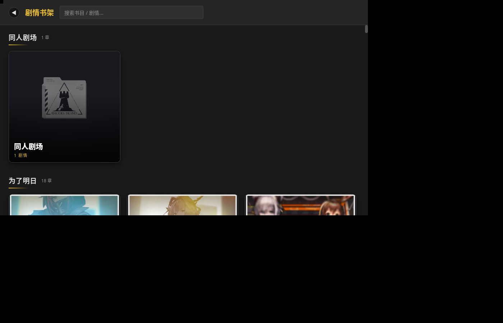 | 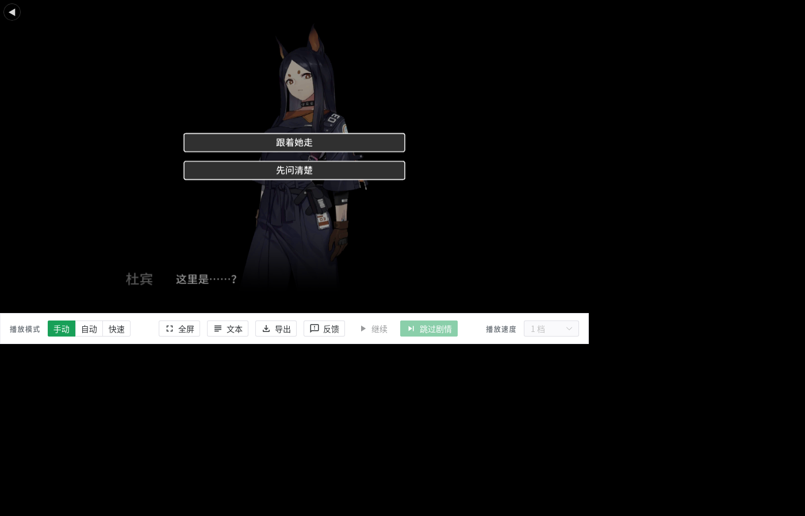 |

### Windows（WebView2）播不出来的两个根因与修复

1. **运行时缺失**：安装器原先用 `downloadBootstrapper`，只在安装那一刻联网拉
   WebView2 Runtime；离线/受限网络下装完仍是空壳。现已改为
   `"webviewInstallMode": { "type": "embedBootstrapper", "silent": true }`
   （`src-tauri/tauri.conf.json`）：bootstrapper 内置进安装器（+1.8 MB），
   安装阶段静默补装。
2. **blob 模块启动失败**：模块图以 `blob:` 脚本注入 iframe，部分 WebView2 下
   会以 `error` 事件失败（只报「StoryPlayer 模块执行失败」）。
   `storyPlayerBoot.ts` 现在**逐模块**加载、捕获 `window.onerror`/`unhandledrejection`
   取真实原因，并在 blob 失败时**自动回退为行内模块**（完成哨兵等待），
   两条路径行为等价。

### 在 Windows 上安装（含缺失 WebView2 的情况）

1. 运行 `Arkstage_1.2.0_x64-setup.exe`。安装器会先查
   `HKLM/HKCU\Software\Microsoft\EdgeUpdate\Clients\{F3017226-…}` 的 `pv`；
   **查不到就静默运行内置的 WebView2 bootstrapper**（`embedBootstrapper`，
   需要一次联网），装完继续安装应用本体。
2. 想**完全离线**安装：把官方 Evergreen Standalone 安装包
   （`https://go.microsoft.com/fwlink/?linkid=2124701`，x64 ≈ 212 MB）先跑一遍，
   `MicrosoftEdgeWebView2RuntimeInstallerX64.exe /silent /install`，
   再装本应用即可（此时安装器检测到 `pv` 就直接跳过）。
3. 只想要便携版：解压 `Arkstage_1.2.0_windows_x64-portable.zip` 到任意目录
   （必须与 `app.exe` 同级保留 `WebView2Loader.dll`），双击 `app.exe`。

### 从首页进「同人剧本」

首页第三个按钮 **同人剧本** → `/fanfic` 目录页：列出已安装的包（标题/章节/简介/分支数），
可 **▶ 播放**、**删除**、**导入剧本包…**（多选目录）、**打开文件夹**、**重新扫描**。
首次启动会自动写入一份**内置样例包**（`sample-fanfic`，自带一份已验证的引擎快照），
所以"空目录"不会出现——打开就能播。

| 目录页 | 内置样例播放（选择面板） |
|---|---|
| 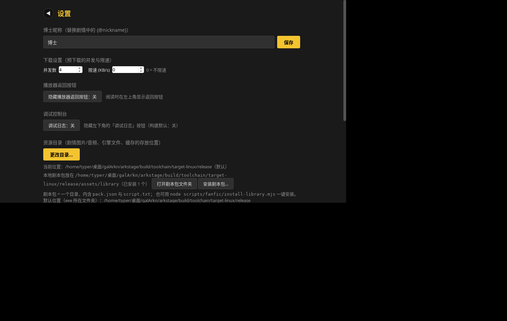 | 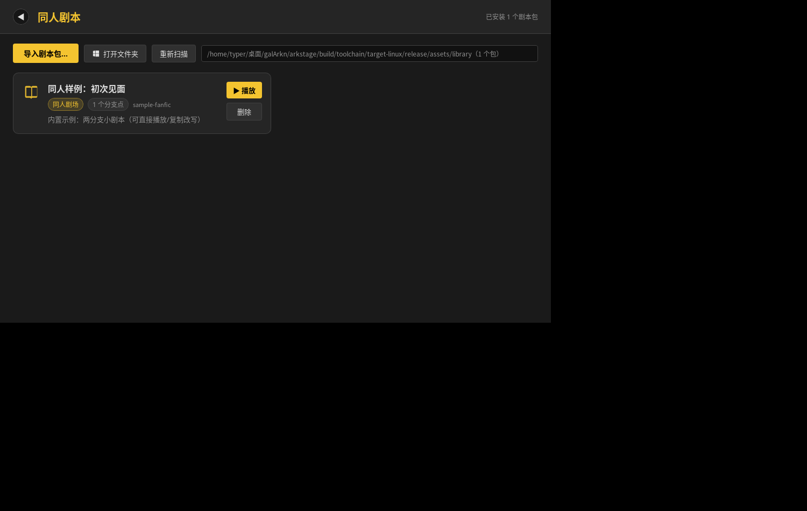 |

## 演出工作台：舞台 + 图形化编辑（不用手敲）

打开 **✎ 编辑** 后，编辑器现在是"看得见的工作台"（借鉴 Yayin Story Studio 的
AStorySyntax / AStoryXRebuilder 思路，做成 React 版）：

- **舞台（16:9）**：按**当前光标行**解析出背景 + 三个槽位（l/m/r）的立绘，
  位置用引擎的几何（`character.json` 的 `pos/size` × 背景 rules）算，和播放器一致；
  选中可**拖动**，松手回写 `enter/xpos1/ypos1`（引擎只认"入场偏移"，见 `animation.md` §3）。
- **控制器检视器**：光标落在某一行 → 右侧按**必填/可选**分组给出参数表：布尔=开关、
  有语料范围的数值=滑杆、枚举=下拉、图片/角色=「从素材里选」；`engineRead:false`
  的键会灰掉并说明原因。改动是**就地补丁**——只重写你改的那一个 `key=value`，
  `[name="X"]  台词` 的正文与空格逐字节保留。
- **插入向导**：「插入控制器…」→ 分类 → 可搜索指令 → 表单 → 预览 → 落行（`Decision`
  还会一次给两行，含配对合流 `[Predicate]`）。
- **预览到此处**：标题下的行定位条，用**前 N 行**合成 runtime 起引擎，不必先保存；
  「放大」可把预览铺到 62% 高。
- **撤销 / 重做（task-15）**：`Ctrl/Cmd+Z` 撤销、`Ctrl/Cmd+Shift+Z` 或 `Ctrl+Y` 重做，
  覆盖**所有**改动路径：打字（连续输入自动合并成一步）、拖立绘（`xpos1/ypos1` 回写）、
  检视器「应用」、插入向导、`Ctrl+Space` 补全、面板插入；状态栏右侧有「撤销 N / 重做 M」
  可点按钮（悬停显示快捷键）。栈上限 200，纯逻辑在 `frontend/src/components/editor/history.ts`。
- **工具窗口（task-15）**：右栏面板、舞台、预览、分支图都是 `InspectorWindow`——
  拖**标题条**移动、拖**右下手柄**缩放、**双击标题条**或点 `⧉` 在停靠/浮动之间切换、
  `✕` 或 `Esc` 关闭；窗口位置尺寸与停靠状态存 `localStorage`（键 `prts-editor-windows:*`），
  刷新后原样恢复。默认仍是原来的停靠布局，不会一进来就变样。
- **可视化节点多线路编排（task-16）**：「⌥ 分支图」窗口把 `[Decision]`/`[Predicate]`
  的**值域**（不是行号跳转——DSL 里根本没有 goto）推成节点与线路：每条线一种颜色 +
  图例、`[Decision]` 用菱形区分、合流点单列；点节点 = 跳到该行，光标行自动高亮并滚入
  可视区；滚轮缩放（0.4×~3×）、拖空白平移。选中节点后「**⤳ 在此分叉**」可按 2~8 个
  选项一次插入 Decision + 每条线的 `[Predicate]` + 末尾合流占位（产物 `lintDocument`
  0 error，`Ctrl+Z` 可整体回退）。推导与「在此分叉」的纯逻辑在
  `src/akstage/local/branchGraph.js`（`buildGraph` / `graphAt` / `routeAtLine` /
  `suggestForkOptions` / `forkPatch`），视图在 `frontend/src/components/editor/BranchGraph.tsx`。
  语义与引擎对齐：`Predicate` 缺省/`references=""` = 全放行（`selectedValue===0 ||
  references===null || length===0`），`values` 缺省按**引擎**取 0（不是 lint 的 `1..N`）。

| 分支图（编辑器内浮动窗口） | 分支图窗口特写 |
|---|---|
| 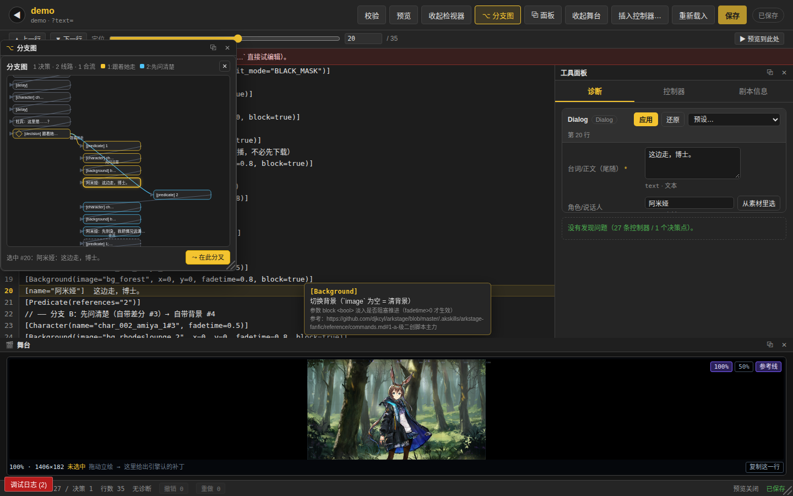 | 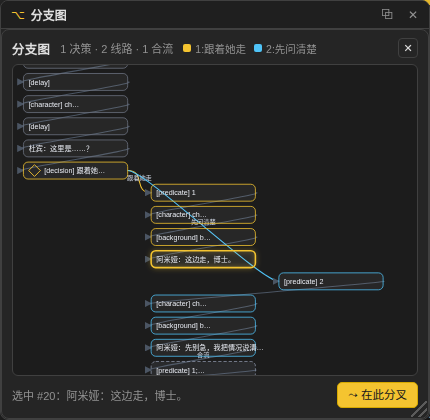 |

| 工作台全貌 | 舞台（拖动/槽位/安全框） | 参数检视器 | 插入向导 |
|---|---|---|---|
| 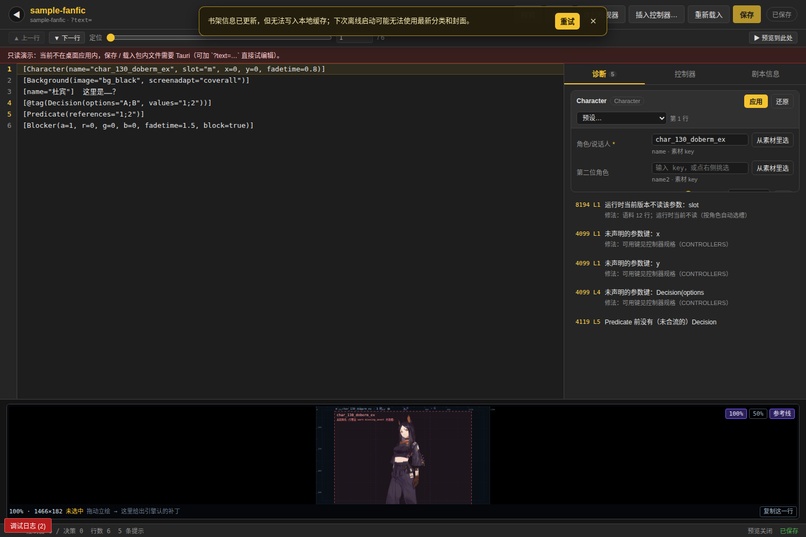 | 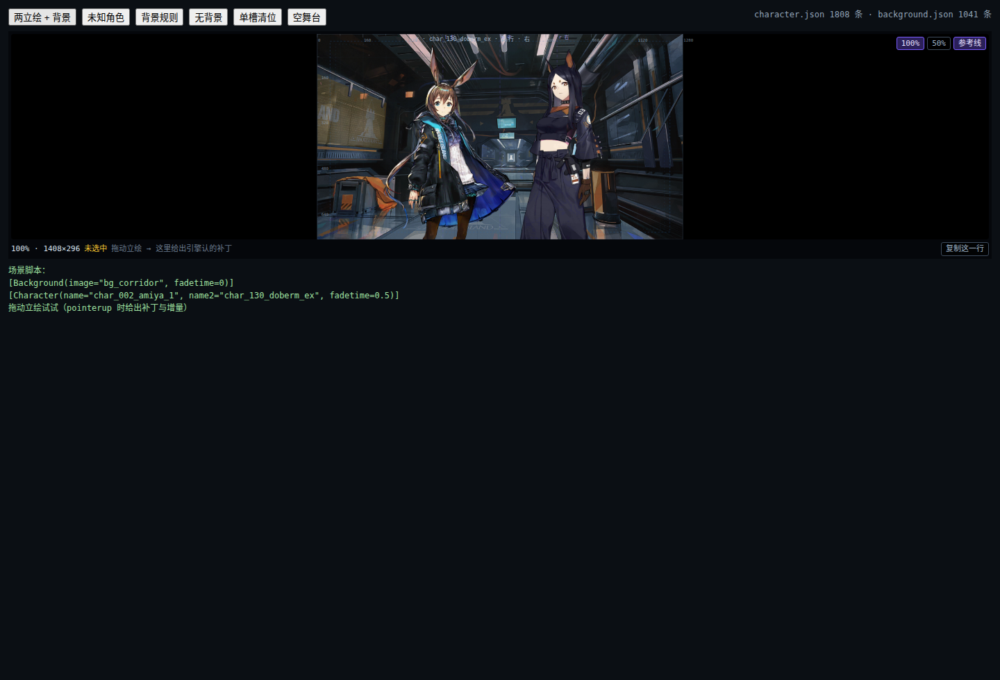 | 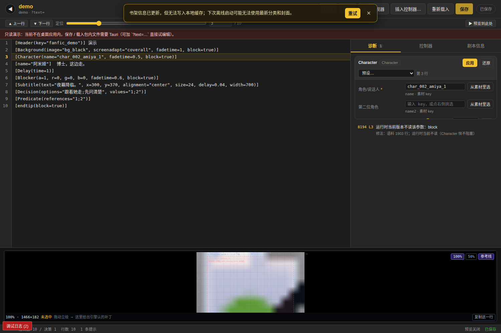 | 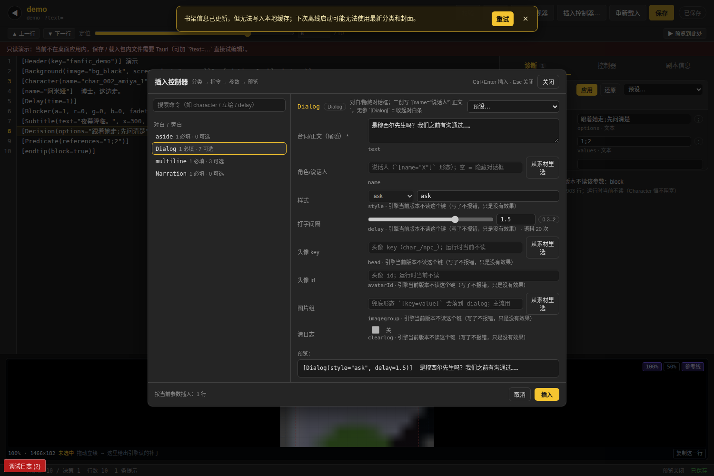 |

回归：`npm run test:editor`（编辑器内核 168 + 文档对齐 + 表单 149）、
`npm run test:stage`（82）、`npm run test:editor:parity` / `test:forms:full`（全语料）、
`node scripts/fanfic/editorUndo-selftest.mjs`（撤销/重做栈 33 断言）、
`node scripts/fanfic/branchGraph-selftest.mjs`（分支图 73 断言：内置样例合流行 vs
`verify-pack` 报告、官方 479 个含 Decision 脚本 0 抛异常、嵌套 depth/线路 id、`forkPatch`
三种选项数、退化输入）。

## 自带素材：样例包不再依赖网络

内置样例 `sample-fanfic` **随包自带 8 张素材**（4 背景 + 4 立绘，382 KB WebP，
出处/哈希见 `src-tauri/resources/assets/sample/SOURCES.md`）。首启 seed 时把它们
写进 `<资源目录>/assets/sample/`（含 `bundles.json` 覆盖层）+ 包内 `assets/`。

播放时**三层兜底**，任何一层单独都能出画：
1. Rust `prts-cdn://` 协议先查覆盖层 `<资源目录>/assets/sample/bundles.json`（worker 也能取，**零网络**）；
2. 包内 `build/assets.local.json` + `pack_asset_path` → `asset://`（覆盖层没有的 key，例如你自己的 OC 立绘）；
3. 都没有才回落到媒体缓存 / PRTS。

| 杜宾 + 选择面板（断网、缓存清空） | 选「跟着她走」→ 阿米娅 | 合流：陈 |
|---|---|---|
| 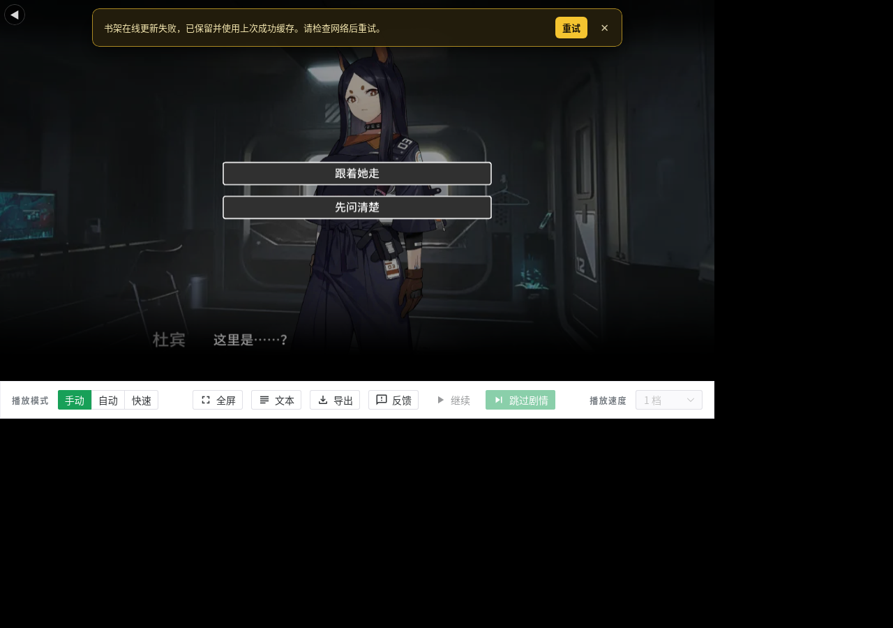 |  |  |

> 验证方式是"删掉整个 `media/` 缓存再播"：画面正常且 `media/` 里只有引擎 JS/字体、
> **没有任何背景/立绘 PNG**，日志 0 条 `加载失败`。门禁三件套：
> 1. `node scripts/fanfic/fetch-sample-assets.mjs --check`（8 份素材的字节数与 sha256）；
> 2. `node scripts/fanfic/verify-pack.mjs --library src-tauri/resources/library --assets
>    --choice 0|1`——headless 里 pack-local **命中 8 / missing 0**，且「自带 key 走了
>    网络」即 FAIL（`--local-broken` 是这条门禁的负例自证）；
> 3. `npm run test:selfcontained`（`scripts/fanfic/selfcontained-check.mjs`）——**真
>    WebKitGTK + Xvfb**：删掉 `assets/library|sample` 与 `media/` 后起 `app`，联网与
>    断网各播一遍，断言覆盖层 8/8 命中、0 条 `加载失败`、`media/` 里 0 张图片。

> ⚠️ 为什么 2 不够：Pixi 的图片解码走 **Worker**，而 `asset://` 是自定义协议，
> WebKitGTK 的 Worker 取不到（`TypeError: Load failed`）；`prts-cdn://` 由 Rust 供给，
> 主线程与 Worker 都能取——所以**覆盖层能命中的 key 一律保留 `prts-cdn://`**（前端
> 用 Rust `bundled_asset_keys()` 判定，数据驱动），命中不了的才回落 `asset://`。

## 播放器底栏

底部那条白色控制条（播放模式/播放速度/全屏/导出…）来自引擎，现在可在
**设置 → 播放器底栏** 里选 **显示 / 自动隐藏 / 隐藏**：自动隐藏 = 3 秒无操作淡出，
指针移动立刻回来；沉浸阅读（安卓横屏）时尤其有用。

## 在应用内编辑（`/editor/:packId`）

「同人剧本」页每张卡片上有 **✎ 编辑**：内置编辑器（借鉴 Project Visindigo 的
Yayin Story Studio / ASERStudio 的 AStorySyntax 思路）——左侧行号 + 当前行高亮，
右侧「诊断 / 控制器 / 剧本信息」三个工具面板，底部状态栏；**Ctrl+S 保存**，
「预览」在页内直接用**当前文本**起演出引擎（不必先保存），「重新载入」丢弃改动从盘上重读。

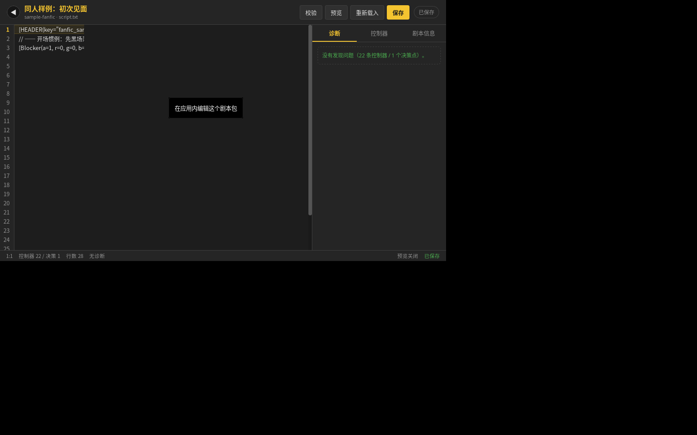

| 补全（`[Cha` + Tab） | 实时诊断（`Delay(tinme=…)` → 缺 `time` + 拼写建议） |
|---|---|
| 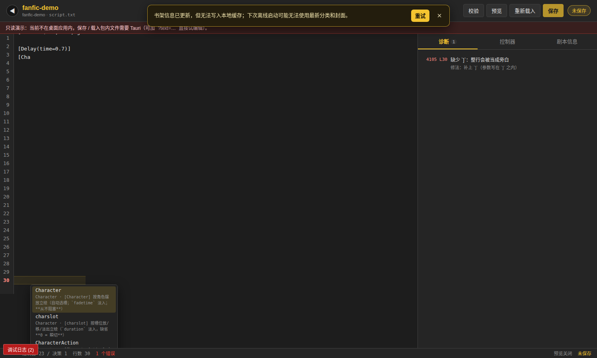 | 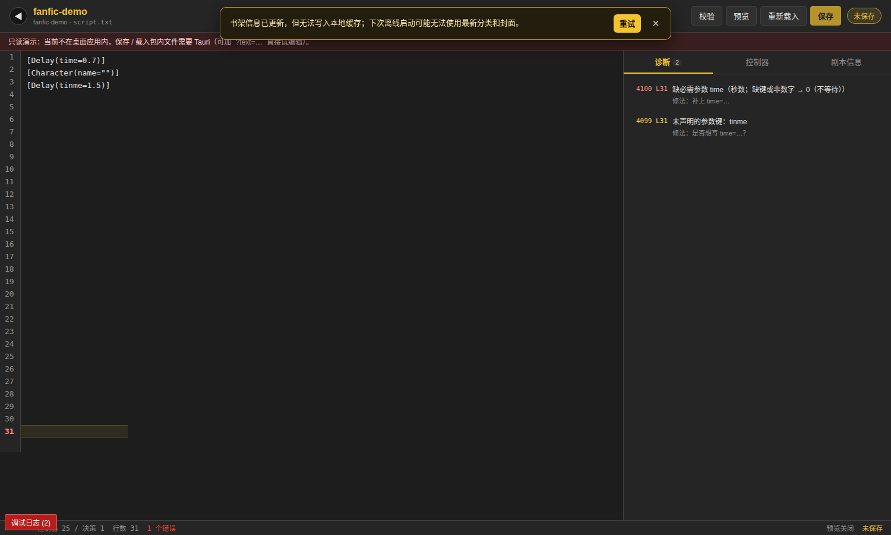 |

诊断带**字符区间**（编辑器里画波浪线）与"修法"提示；控制器面板按 YSS 式分类
（背景 / 立绘 / 对白 / 停顿 / 遮罩 / 镜头 / 字幕 / 音乐 / 音效 / 选择 / 分支收尾…）点击即可插入骨架。
内核回归：`npm run test:editor`（编辑器内核 168 + 文档 + 表单 149 + **区域缩进 114**）。

### 区域缩进（`Decision` 分支体不再手敲空格）

用户原话：编辑器页面「大多数是字符，不方便中文用户入手」。区域缩进把
`[Decision]` / `[Predicate]` 的分支体排成层级，**只影响可读性、不影响播放**：

```
[Decision(options="跟着她走;先问清楚", values="1;2")]
  [Predicate(references="1")]
    [charslot(slot="m", name="char_002_amiya_1#1", duration=0.5)]
    [name="阿米娅"]  这边走，博士。
  [Predicate(references="2")]
    [name="阿米娅"]  先别急，我把情况说清楚。
[End]
```

层级约定（`regionIndentPlan`，两空格一级）：

| 行 | 缩进 |
|---|---|
| `[Decision]` / `[End]` / `[endtip]` | 顶格（0） |
| `[Predicate(references=…)]`（线路头，含合流） | 1 级 |
| 线路体（该 `Predicate` 之后，到下一条线路/合流/`[End]`/EOF） | 2 级 |

- **编辑器容忍**：行首空格/Tab 在 `parseLine` / `parseScript` / `lintScript` 里等价于
  "不存在"——缩进版与顶格版给出**同一** kind 序列、同一组诊断（span 整体平移），
  缩进的指令行不再报 `NarrationLine`。`ParseResult.leading` 挂出行首空白。
- **送引擎前归一化**：`storyPack.stripIndentForEngine`（`library.stripControls` 会调）
  只对去缩进后以 `[` 开头的行去行首空白；**纯旁白行原样**（行首空白是展示文本的
  一部分），**`\` 续行的物理行**同样原样（由 `[` 行拼掉）。因此 `buildHook` 产出的
  `story.script` 与顶格版**逐字节相等**，`revision` 也一致。
- **Tab / 奇数格缩进**：`UseSpaceInsteadTab`（0x100C）对**行首 Tab** 保留提示，
  但降级为提示级；`BadIndentation`（0x1019）提示"宽度不是 2 的整数倍"。
  引擎本身（`parser.ts` 的 `commandRegex` 无 `m`、`logicalLines` 不 trim）会把
  缩进指令行当旁白，所以归一化是播放正确性的必要条件，不只是美化。
- 纯函数：`editorModel.indentLines(text, from, to, "indent"|"outdent")`（区间缩进，
  只动行首空白，往返幂等）与 `editorModel.regionIndentPlan(text)`（整段分层重排，幂等）。
- 回归：`node scripts/fanfic/editorIndent-selftest.mjs`（114 断言：解析容忍 /
  诊断对拍 / 归一化逐字节 / `buildHook` / `indentLines` / `regionIndentPlan` 层级与
  幂等 / demo `runtime.json` 的 `story.script` 对拍）。

### 演出动效（为什么"动画好奇怪"）

内置样例与 skill 都对齐了引擎**真正**读的参数：
- `[Delay(time=…)]`（`duration`/`TIME` 一律按 0）；
- 立绘淡入用 `[Character(name=…, fadetime=…)]`；按槽位站位才 `[charslot(…, duration=…, isblock=true)]`（`duration` 缺省 = **瞬切**）；
- 换场惯例：黑场 → 换背景/音乐 → 去黑场，`fadetime` 明写；
- 收尾只认 `[endtip(block=true)]`（或 `[Blocker(a=1, …)]` 淡出）；**`[End]` 不是引擎指令**，写了会 warn 然后停在最后一帧。

完整清单：[`reference/animation.md`](../../.akskills/arkstage-fanfic/reference/animation.md)；
11 个可整段复制的预设在 [`templates/performance.md`](../../.akskills/arkstage-fanfic/templates/performance.md)。
回归：`node scripts/fanfic/animation-selftest.mjs`（把文档里的每个片段喂给解析器 +
和引擎 `runtime.ts` 的参数名逐个比对）。

| 目录页（内置样例） | 播放：立绘入场 |
|---|---|
|  |  |

### 同人剧本包放哪里？

设置 → 资源目录 一节现在会显示**确切的剧本包目录**，并提供两个按钮：

- **打开剧本包文件夹** → 用资源管理器打开 `<资源目录>\assets\library\`
- **安装剧本包…** → 选一个含 `pack.json` + `script.txt` 的目录，自动复制进去

命令行等价物：
```bash
node scripts/fanfic/install-library.mjs example/library --data-root "<设置页里显示的资源目录>"
```
放好后回到书架即可看到「同人剧场」（书架每次进入都会重扫，不必重启）。

### Windows WebView2 的 CSP 拦截（2026-10-07 实机日志定位）

日志形态：一串 `CSP blocked script-src-elem: https://static.prts.wiki/widgets/production/*.js`
+ `resource load failed: blob:…` → `PRTS engine 模块执行失败`。

两个成因与修复：
1. **CSP 白名单缺上游域名**。`tauri.conf.json` 的 `script-src` 只有 `'self' blob:
   code.jquery.com`，而 StoryPlayer 会给自己的 chunk 插 `<link rel="modulepreload">`
   指向 `https://static.prts.wiki/widgets/production/*.js`；
   `modulepreload-polyfill` 还会 `fetch()` 同一批 URL。现已在
   `script-src`/`connect-src`/`img-src`/`media-src`/`font-src`/`style-src` 加白
   `https://static.prts.wiki https://torappu.prts.wiki https://media.prts.wiki`。
2. **preload 链接没有走 blob**。`storyPlayerBoot.ts` 新增
   `installPreloadRewrite()`：把 `<link rel=modulepreload>` 的 `href`（含运行时
   动态插入的）改写为 import map 里**同一个模块**的 blob URL —— 预加载仍命中
   已加载的模块实例（恒等性不变），且不再触发 CSP。

回归方式：`node scripts/fanfic/csp-probe.mjs --csp [--strict-csp]`（用
`tauri.conf.json` 的真实 CSP 起一个页面跑 `bootEngineInFrame`；`--strict-csp`
把 `script-src` 收窄以复现 Windows 场景）。
